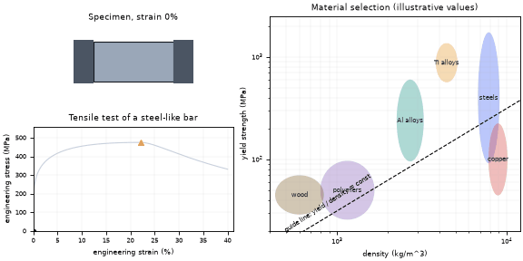
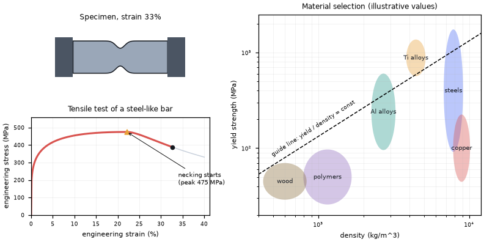
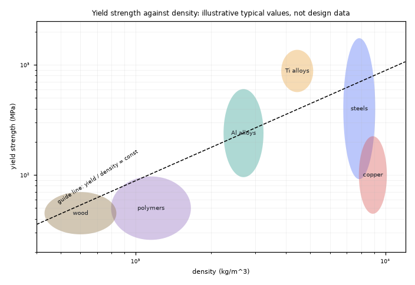
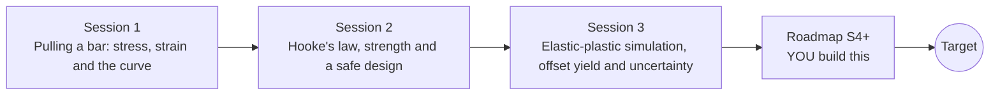

# openstressstrain

[](https://github.com/KrunalPanchal1995/openstressstrain/actions/workflows/ci.yml)   [](https://colab.research.google.com/github/KrunalPanchal1995/openstressstrain/blob/main/sessions/session-01/lesson.ipynb) [](https://krunalpanchal1995.github.io/openstressstrain/)

**Read a stress-strain curve and pick a safe material, in three sessions.**

openstressstrain teaches how engineers turn a pull test into stress, strain, stiffness, yield and a factor of safety, using only Python and a browser.

- **Start from zero.** Session 1 needs only a force, an area and a length; every symbol is explained.
- **See it stretch.** Every session ships a slider app that runs in the browser, with labelled graphs.
- **Know you got it right.** Each session ends with a checkpoint that prints PASS or FAIL against hand calculations.
- **Build the missing half.** The repo stops at Session 3 on purpose; the roadmap shows the path to the Target.

[Target](#the-target) · [Who is this for](#who-is-this-for) · [Quick start](#quick-start) · [Sessions](#sessions) · [Roadmap](#roadmap) · [Contribute](#contribute) · [Explainer PDF](docs/explainer.pdf)

> **This repo is incomplete on purpose.** Sessions 1 to 3 are here and fully working. The finished Target below is a preview of what the community can build next. We show you the path, not the code. Sessions 4 and up are yours.

## The Target

A metal test bar is pulled in an animated tensile test. The specimen stretches evenly, then a neck forms and the engineering stress drops until the bar breaks, while the stress-strain curve is drawn live. Beside it, an Ashby-style chart of yield strength against density shows where common material families sit and which one gives the lightest safe rod. Your goal over the coming sessions: build the necking curve and the selection chart yourself.



*Target: animated tensile test with necking, and a material-selection chart*



*Target still: the engineering curve and the Ashby-style chart*



*Material-selection chart: yield strength against density (illustrative values)*

Try it live:

- [Math Visual Studio: constitutive relations (Atlas S65)](https://krunalpanchal1995.github.io/studio/#atlas?ch=S65&ex=1)
- [Math Visual Studio: open the Studio](https://krunalpanchal1995.github.io/studio/)

How the Target was made is shown only as a path in [promo/roadmap.md](promo/roadmap.md).

## Who is this for
**secondary school to diploma / undergraduate (levels 3-5).** Topic area: Chemistry and Materials Science.

Prerequisites:

- Multiplication, division and simple units (newtons, millimetres); the idea of a graph with two axes.
- Python 3.10 or newer; if `python --version` works, you are ready. PRIMER.md explains the rest.
- No prior GitHub, mechanics or engineering experience is needed.

New to Python? Read [PRIMER.md](PRIMER.md) first (10 minutes).

## Quick start

No installation knowledge needed. You need [Git](https://git-scm.com/downloads) and [Python 3.10+](https://www.python.org/downloads/) (Windows: tick "Add Python to PATH"). On Mac and Linux type `python3` wherever this page says `python`.

```bash
git clone https://github.com/KrunalPanchal1995/openstressstrain.git
cd openstressstrain
python start.py 1
```

`start.py` creates a private environment, installs what is needed and runs Session 1 with its checkpoint. Next: `python start.py 2`, `python start.py 3`, or `python start.py test` to check everything. Only a checkpoint: `python start.py check 1`.

Four lines turn the idea of Session 1 into a result (they work as they are): Save it as `try.py` and run it with `python start.py run try.py` (this uses the private environment, where NumPy is installed):

```python
import numpy as np
A = np.pi * 10.0**2 / 4                 # area of a 10 mm round bar, mm^2
stress = 15 * 1000 / A                  # 15 kN pulled, stress in MPa
print(round(stress, 1), 'MPa; strain at E = 70 GPa =', round(stress / 70000, 5))   # -> 191.0 MPa; 0.00273
```

Every session also opens in your browser with sliders (no install): [live apps](https://krunalpanchal1995.github.io/openstressstrain/). Or use the Colab badge above for the notebook.

## Sessions

| # | Session | Model level | Time | Live app |
|---|---|---|---|---|
| 1 | [Pulling a bar: stress, strain and the curve](sessions/session-01/README.md) | Level 1: conceptual interactive model | 60 min | [open](https://krunalpanchal1995.github.io/openstressstrain/session-01/) |
| 2 | [Hooke's law, strength and a safe design](sessions/session-02/README.md) | Level 2: mathematical engineering model | 75 min | [open](https://krunalpanchal1995.github.io/openstressstrain/session-02/) |
| 3 | [Elastic-plastic simulation, offset yield and uncertainty](sessions/session-03/README.md) | Level 3: simulation and validation | 90 min | [open](https://krunalpanchal1995.github.io/openstressstrain/session-03/) |

Each session follows the same six steps: A real-world problem, B concept and theory, C visual explanation, D interactive simulation, E worked example and experiment, F assessment and design challenge. Each ends with `checkpoint.py`, which prints `PASS` or `FAIL` against reference numbers. Session 3 also contains the real-world mini-project: **Estimate E and yield from a noisy tensile test**.

## Architecture



| Folder or file | What is inside |
|---|---|
| `sessions/` | three sessions: README (A-F), `lesson.py`, notebook, live app, exercises, activity sheet, checkpoint |
| `promo/` | the Target: media, live links, and the roadmap (path only) |
| `docs/` | `explainer.tex` and the built `explainer.pdf` |
| `tests/` | runs every lesson and checkpoint headless |
| `start.py` | one command to set up and run anything |
| `QUALITY.md`, `RUBRIC.md` | the quality checklist and the scoring rubric |
| `.github/` | CI, PDF build, Pages deploy, issue and PR templates |

## Roadmap

| Milestone | What you will build | Difficulty |
|---|---|---|
| Session 4: True stress, true strain and necking | A converter from engineering to true stress and strain and a detector of the necking point on a power-law hardening metal. | intermediate |
| Session 5: Fit the whole curve with uncertainty | A fitting script with a chosen fit window and a bootstrap estimate of the spread. | intermediate |
| Session 6: Material selection by strength per density | A table and an Ashby-style log-log chart of yield strength against density with a guide line. | intermediate |
| Session 7: Probability of failure by Monte Carlo | A sampler that draws yield from a normal distribution and reports the failure probability. | advanced |
| Session 8: Reproduce the Target: tensile test with necking and a selection chart | An animated specimen, a live engineering curve and a log-log chart. | advanced |

Full detail with a checkpoint per milestone: [promo/roadmap.md](promo/roadmap.md).

## Contribute
New to GitHub? Read [CONTRIBUTING.md](CONTRIBUTING.md); it starts from zero. Pick an issue labelled `good first issue`. Translations into Hindi, Telugu, Tamil and Malayalam are welcome.

<details>
<summary>Development</summary>

```bash
python start.py test        # runs every lesson and checkpoint
```
Lessons use `# %%` cell markers so they open as notebooks in VS Code. See [QUALITY.md](QUALITY.md) for the standard every session meets.
</details>

## License
MIT. See [LICENSE](LICENSE). Media in `promo/media` is (c) Krunal Panchal, CC BY 4.0.

## Acknowledgments
Part of the [PAN IIT OSS](https://hellofoss.tech-iitb.org/projects) open-source teaching collection, modelled on the structure of [openspline](https://github.com/openspline/openspline). Built on ideas from the Math Visual Studio at https://krunalpanchal1995.github.io/studio/.
