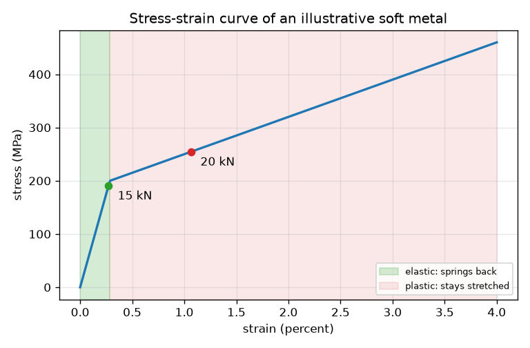
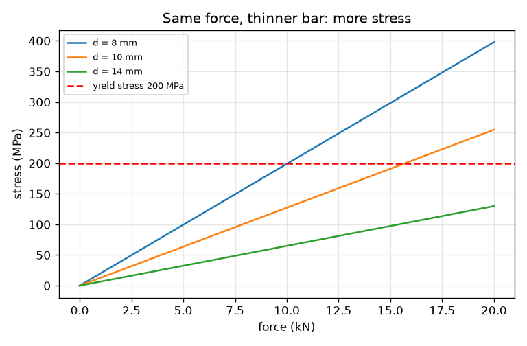

# Session 1: Pulling a bar: stress, strain and the curve

*Level 1 (conceptual interactive model) · about 60 minutes · openstressstrain*

> This is a simplified educational model. It is not a validated design tool and must not be used for real structures, electrical installations, vehicles, industrial processes or medical decisions.

**Prerequisites**

- Area of a circle, and units of force (newton, kilonewton).
- You have read PRIMER.md and run `python start.py 1` once.

**Learning objectives.** After this session you can:

- Compute stress (force divided by area) and strain (extension divided by length) for a pulled bar.
- Explain why engineers use stress and strain instead of force and extension.
- Read a stress-strain curve and mark the elastic region and the plastic region.
- Say what happens to the bar when the load is removed in each region.

## A. Real-world problem
A lift cable, a bicycle spoke and a paper clip all get pulled or bent. Pull a paper clip a little and it springs back; pull it hard and it stays bent. How can we describe this with numbers that do not depend on how thick or long the part is? This session uses an illustrative soft metal with round made-up numbers to teach the idea. It is a teaching model, not a design tool, and not data for any real alloy.

## B. Concept and theory
Pull a bar with a force F. The material feels stress: force spread over the cross-section area A. The bar gets longer by an extension dL; dividing by the original length L0 gives strain, which has no unit. A plot of stress against strain is the stress-strain curve, and it describes the material, not the sample. At small stress the bar is elastic: it returns to its original length when you let go, and strain is proportional to stress. Beyond the yield stress it is plastic: it stretches more easily and part of the stretch stays when the load is removed (permanent set).

| Symbol | Meaning | Unit |
|---|---|---|
| F | pulling force | kN |
| A | cross-section area, pi d^2 / 4 for a round bar | mm^2 |
| d | bar diameter | mm |
| sigma | stress = F / A (1 N/mm^2 = 1 MPa) | MPa |
| dL | extension | mm |
| L0 | original length (500 mm here) | mm |
| eps | strain = dL / L0 | no unit (0.01 is 1 percent) |
| E | stiffness of the illustrative metal (70 000) | MPa |
| sigma_y | yield stress of the illustrative metal (200) | MPa |

**Assumptions**

- The pull is straight along the bar and spread evenly over the area.
- Stress and strain are 'engineering' values: area and length are the original ones.
- The metal is an invented soft metal with E = 70 GPa, yield 200 MPa and a gentle slope after yield; it is not data for any real alloy.
- No necking, no temperature or speed effects. This is not a design tool.

$$ \sigma=\frac{F}{A},\qquad A=\frac{\pi d^2}{4} $$

$$ \varepsilon=\frac{\Delta L}{L_0} $$

$$ \sigma=E\,\varepsilon\quad(\sigma\le\sigma_y),\qquad \varepsilon_{\text{permanent}}=\varepsilon-\frac{\sigma}{E} $$

## C. Visual explanation
The first figure is the stress-strain curve of the illustrative metal. The green band is the elastic region, a straight steep line that ends at the yield stress of 200 MPa (strain 0.29 percent). The pink band is the plastic region, where the curve is much flatter. The two dots mark pulls of 15 kN (inside the elastic band) and 20 kN (in the plastic band) on a 10 mm bar. The second figure shows that for the same force a thinner bar has a higher stress, and the red dashed line is the yield stress that the thin bars cross first.

*Stress-strain curve of the illustrative metal with the elastic and plastic regions marked.*

*Stress against force for three diameters; thinner bars reach the yield stress sooner.*

## D. Interactive simulation
Run the lesson (`python start.py 1`), then open the live app: [Session 1: pull a bar](https://krunalpanchal1995.github.io/openstressstrain/session-01/) (or `app.html` in this folder). Move the force and diameter sliders and watch the bar stretch, the dot move along the curve, and the dashed unloading line show how much stretch would stay.

**Challenge.** Make the bar plastic (stress above 205 MPa) while using a force of at most 15 kN.

## E. Worked example and experiment
**Problem.** A round bar of diameter 10 mm and length 500 mm is pulled by 15 kN. Find the stress, the strain and the extension, and say whether it is elastic. The yield stress is 200 MPa and E is 70 000 MPa.

1. Area A = pi * 10^2 / 4 = 78.54 mm^2.
2. Stress = 15 * 1000 N / 78.54 mm^2 = 191.0 MPa.
3. 191.0 MPa is below the 200 MPa yield, so the bar is elastic and strain = stress / E = 191.0 / 70 000 = 0.002728.
4. Extension = strain * L0 = 0.002728 * 500 = 1.364 mm.
5. Sanity check: 1.4 mm in 500 mm is a small fraction (0.27 percent), as expected for a stiff metal.

**Answer.** Stress 191.0 MPa, strain 0.00273, extension 1.36 mm, elastic. At 20 kN the stress is 254.6 MPa, the bar is plastic, the strain is 0.01066 (5.33 mm) and after unloading 0.00703 (3.51 mm) of stretch stays.

**Experiment.** Hang a thin steel wire or a long strip of rubber from a hook, add known weights and measure the stretch with a ruler. Plot weight against stretch: a straight line means elastic. For a paper clip, bend a small angle (it springs back) and then a large angle (it stays bent) to feel the elastic and plastic regions. The model differs from reality because real metals curve smoothly into yield, and because the clamp, the wire kinks and the ruler reading add errors of a millimetre or more.

## F. Assessment and design challenge
**Question type A: Conceptual.** Why do engineers plot stress against strain instead of force against extension?

Hint

Think of a thick bar and a thin bar of the same metal. Do they need the same force to break?

Step-by-step solution

A thick bar needs a larger force than a thin bar to reach the same damage, and a long bar stretches more than a short one. Dividing the force by the area and the extension by the length removes the size of the sample, so one curve describes the material and can be used for any size.

**Question type B: Numerical.** A bar of diameter 8 mm and length 500 mm is pulled by 10 kN (yield 200 MPa, E = 70 000 MPa). Find the stress, strain and extension. Is it elastic?

Hint

A = pi d^2 / 4 first, then stress = F / A.

Step-by-step solution

A = pi * 8^2 / 4 = 50.27 mm^2. Stress = 10 000 / 50.27 = 198.9 MPa. This is just below the 200 MPa yield, so the bar is elastic. Strain = 198.9 / 70 000 = 0.002842 and extension = 0.002842 * 500 = 1.42 mm. Units: MPa, no unit, mm. Sanity check: the stress is close to yield, so the bar is almost at its limit.

**Question type C: Graph and simulation interpretation.** On the stress-strain curve, at what strain does the curve bend, and how does the slope change there?

Hint

Strain at yield = yield stress / E. The slope after yield is 7 000 MPa.

Step-by-step solution

The bend is at strain 200 / 70 000 = 0.00286 (0.29 percent). Before it the slope is E = 70 000 MPa; after it the slope is 7 000 MPa, ten times flatter. A flatter curve means the metal needs much less extra stress to stretch further, and the stretch is no longer recoverable.

**Question type D: Design and optimisation challenge.** Design: choose the smallest whole-millimetre diameter so that an 18 kN pull keeps the stress at or below 90 percent of the yield stress. State the stress and the extension of your choice.

Hint

The allowed stress is 0.9 * 200 = 180 MPa, so A must be at least F divided by that.

Step-by-step solution

A >= 18 000 / 180 = 100 mm^2, so d >= sqrt(4 * 100 / pi) = 11.28 mm; the smallest whole millimetre is 12 mm. Check: A = 113.1 mm^2, stress = 159.2 MPa (about 80 percent of yield), strain = 0.002274 and extension = 1.14 mm. d = 11 mm would give 189.4 MPa, too close to yield. Trade-off: a thicker bar is safer but heavier and costlier.

Score yourself with [RUBRIC.md](../../RUBRIC.md). Print the [activity sheet](activity_sheet.md) to work on paper.

## Common misconceptions
| Common misconception | What is actually true |
|---|---|
| A stronger bar always stretches less. | Stretch under load depends on stiffness (E), not on how strong the material is; strength tells you when it yields. |
| Stress is the same as force. | Stress is force per area; the same force makes a thin bar highly stressed and a thick bar lightly stressed. |
| After yield the bar is broken. | Yield only means permanent stretching begins; the bar can still carry more load before it fails. |

## Glossary
- **stress**: force divided by cross-section area; unit MPa
- **strain**: extension divided by original length; no unit
- **elastic**: returns to its original shape when the load is removed
- **plastic**: keeps part of the deformation after the load is removed
- **yield stress**: stress at which permanent stretching begins
- **permanent set**: strain that remains after unloading

## Finish
1. Do the three coding tasks in [exercises.md](exercises.md).
2. Run `python start.py 1` again after your changes. It ends with the checkpoint; when it prints `PASS`, you are done. (Checkpoint only: `python start.py check 1`.)

Next: [Session 2](../session-02/README.md)
