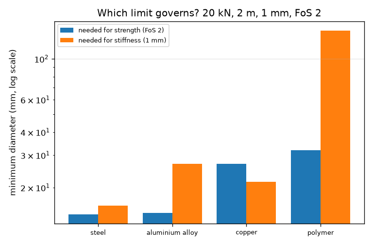
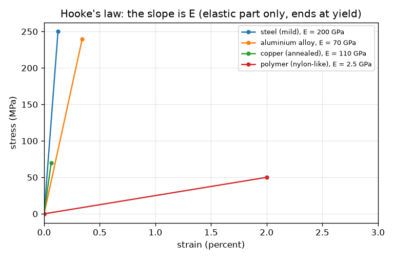

# Session 2: Hooke's law, strength and a safe design

*Level 2 (mathematical engineering model) · about 75 minutes · openstressstrain*

> This is a simplified educational model. It is not a validated design tool and must not be used for real structures, electrical installations, vehicles, industrial processes or medical decisions.

**Prerequisites**

- Session 1: stress, strain and the elastic region.
- Solving a simple equation for one unknown.

**Learning objectives.** After this session you can:

- Use Hooke's law sigma = E * eps and the extension formula dL = F L / (A E).
- Tell apart stiffness (E), yield strength and ultimate strength.
- Compute a factor of safety and use it to size a bar.
- Choose a material and diameter that meet both a strength limit and a stretch limit, and say which limit governs.

## A. Real-world problem
A 20 kN load (about 2 tonnes) hangs from a 2 m rod. The rod may stretch by at most 1 mm and must have a factor of safety of 2 against yielding. Which material and which diameter would you choose? This session uses round typical textbook values for four materials. They are for teaching, not design data, and this is not a design tool: real parts also need buckling, joint, fatigue and temperature checks and certified material data.

## B. Concept and theory
In the elastic range stress is proportional to strain: sigma = E eps. E is Young's modulus, the stiffness. Combining sigma = F/A and eps = dL/L gives the extension of a bar: dL = F L / (A E). Yield strength sigma_y is the stress where permanent stretching starts and ultimate strength sigma_u is the highest stress on the curve. The factor of safety is yield strength divided by the working stress. A bar must satisfy two limits: strength (stress <= sigma_y / FoS gives a minimum area) and stiffness (dL <= limit gives another minimum area). The larger area governs.

| Symbol | Meaning | Unit |
|---|---|---|
| E | Young's modulus (stiffness) | MPa (1 GPa = 1000 MPa) |
| sigma_y | yield strength | MPa |
| sigma_u | ultimate strength | MPa |
| rho | density | kg/m^3 |
| F | load (20) | kN |
| L | length (2000) | mm |
| dL_max | allowed extension (1.0) | mm |
| FoS | factor of safety = sigma_y / sigma | no unit |
| m | bar mass = rho A L | kg |

**Assumptions**

- The bar is loaded in pure tension, along its axis, and stays elastic.
- Material values are round typical numbers (steel E 200 GPa, yield 250 MPa; aluminium alloy 70 GPa, 240 MPa; annealed copper 110 GPa, 70 MPa; nylon-like polymer 2.5 GPa, 50 MPa). Real values vary a lot with alloy, temper and temperature.
- The weight of the bar itself and any joints are ignored. Not a design tool.

$$ \sigma=E\,\varepsilon,\qquad \Delta L=\frac{F\,L}{A\,E} $$

$$ \mathrm{FoS}=\frac{\sigma_y}{\sigma},\qquad A\ge\frac{F\,\mathrm{FoS}}{\sigma_y} $$

$$ A\ge\frac{F\,L}{E\,\Delta L_{\max}},\qquad m=\rho\,A\,L $$

## C. Visual explanation
The first figure draws the elastic line of each material (stress against strain) up to its yield point. The slope is E: steel is steepest, the polymer almost flat, and the polymer's line ends at 2 percent strain while steel's ends at only 0.125 percent. The second figure compares, for each material, the diameter needed for strength and the diameter needed for stiffness on a log scale. For steel, aluminium and the polymer the stiffness bar is higher, so stiffness governs; for copper the strength bar is higher, so strength governs.

*Minimum diameter for strength and for stiffness of each material (log scale).*

*Elastic stress-strain lines of four typical materials; the slope is E and each line ends at yield.*

## D. Interactive simulation
Run the lesson (`python start.py 2`), then open the live app: [Session 2: size a hanging bar](https://krunalpanchal1995.github.io/openstressstrain/session-02/) (or `app.html` in this folder). Choose a diameter, E and yield strength (or press a material preset) and watch the extension, the factor of safety and the pass or fail message. Switch to the extension graph to see how a thicker bar cuts the stretch.

**Challenge.** Find a bar that stretches at most 1 mm, has a factor of safety of at least 2, and is no thicker than 18 mm.

## E. Worked example and experiment
**Problem.** A steel bar (E = 200 000 MPa, yield 250 MPa, density 7850 kg/m^3) of length 2 m carries 20 kN. Find the smallest whole-millimetre diameter with FoS >= 2 and extension <= 1 mm, and check it.

1. Strength: A >= 20 000 * 2 / 250 = 160 mm^2, so d >= 14.27 mm.
2. Stiffness: A >= 20 000 * 2000 / (200 000 * 1) = 200 mm^2, so d >= 15.96 mm.
3. The larger diameter governs (stiffness), so d = 16 mm (next whole millimetre). A = 201.06 mm^2.
4. Check: stress = 20 000 / 201.06 = 99.5 MPa; FoS = 250 / 99.5 = 2.51; extension = 99.5 * 2000 / 200 000 = 0.995 mm.
5. Mass = 7850 * 201.06e-6 * 2 = 3.16 kg.

**Answer.** d = 16 mm: stress 99.5 MPa, factor of safety 2.51, extension 0.995 mm, mass 3.16 kg. Stiffness governs. Over the four materials the lightest passing bar is the aluminium alloy at d = 27 mm (3.09 kg), only 2 percent lighter than steel, so the choice is sensitive to the data.

**Experiment.** Hang 1, 2 and 3 kg masses from a 1 m steel wire (for example a 1 mm guitar string) and measure the stretch with a ruler or a phone camera. The stretch is tiny (a fraction of a millimetre), so use a long wire and a magnifying marker. Compute E from the slope of load against stretch and compare with 200 GPa: you will get a value within a factor of two, because wire is not the same steel, the clamp slips and the measurement is crude.

## F. Assessment and design challenge
**Question type A: Conceptual.** Steel and the aluminium alloy in the table have almost the same yield strength, yet the aluminium bar must be much thicker to meet the 1 mm limit. Why?

Hint

Which property controls how much a bar stretches, strength or stiffness?

Step-by-step solution

The extension depends on E, the stiffness, not on the yield strength. Aluminium has about a third of the stiffness of steel (70 against 200 GPa), so for the same load it stretches nearly three times as much unless its area is larger. Strength only decides when the metal yields.

**Question type B: Numerical.** An aluminium bar (E = 70 000 MPa, yield 240 MPa) of diameter 27 mm and length 2 m carries 20 kN. Find the stress, the extension and the factor of safety.

Hint

A = pi d^2 / 4; stress = F / A; dL = stress * L / E; FoS = yield / stress.

Step-by-step solution

A = 572.56 mm^2. Stress = 20 000 / 572.56 = 34.93 MPa. Extension = 34.93 * 2000 / 70 000 = 0.998 mm, just inside the 1 mm limit. FoS = 240 / 34.93 = 6.87. Sanity check: the factor of safety is far above 2 because the stretch limit, not strength, sized the bar.

**Question type C: Graph and simulation interpretation.** In the first figure (stress against strain lines), which material is stiffest and which stretches most at its own yield point? Give the strain values.

Hint

The slope is E; the strain at yield is yield / E.

Step-by-step solution

Steel has the steepest line (E = 200 GPa). Strain at yield: steel 250 / 200 000 = 0.00125 (0.125 percent); aluminium 0.00343; copper 0.00064; the polymer 50 / 2500 = 0.02 (2 percent), the largest. The polymer is the least stiff and stretches most before yield, even though its yield stress is the lowest.

**Question type D: Design and optimisation challenge.** Design: the allowed extension is relaxed from 1 mm to 2 mm for the same 20 kN, 2 m, FoS 2. Which of the four materials gives the lightest bar, with a whole-millimetre diameter, and what are its diameter and mass?

Hint

Compute both minimum diameters for each material (use `best_design(dl_max=2.0)`), take the larger, round up and compare masses.

Step-by-step solution

Aluminium alloy: strength d >= 14.57 mm, stiffness d >= 19.07 mm, so d = 20 mm, mass 1.70 kg, extension 1.82 mm, FoS 3.77. Steel: stiffness 11.28 mm, strength 14.27 mm (strength now governs), d = 15 mm, mass 2.77 kg. Copper needs 27 mm (10.19 kg) and the polymer 101 mm (18.43 kg). The aluminium alloy is lightest. Trade-off: a looser stretch limit makes the lighter, less stiff material attractive; cost, joining and the scatter of real material data also matter.

Score yourself with [RUBRIC.md](../../RUBRIC.md). Print the [activity sheet](activity_sheet.md) to work on paper.

## Common misconceptions
| Common misconception | What is actually true |
|---|---|
| A higher yield strength means a stiffer bar. | Stiffness is E. Two metals can have similar yield strengths and very different E. |
| A factor of safety of 2 means the bar is twice as strong. | It means the working stress is half the yield stress; it is a margin against uncertainty, not a measure of strength. |
| The designer only has to check strength. | A bar can be strong enough and still stretch too much; both limits must be checked and the larger area governs. |

## Glossary
- **Young's modulus (E)**: stiffness: stress needed per unit strain in the elastic range
- **Hooke's law**: stress is proportional to strain in the elastic range
- **yield strength**: stress at which permanent deformation starts
- **ultimate strength**: highest stress on the stress-strain curve
- **factor of safety**: yield strength divided by working stress
- **density**: mass per volume, kg/m^3

## Finish
1. Do the three coding tasks in [exercises.md](exercises.md).
2. Run `python start.py 2` again after your changes. It ends with the checkpoint; when it prints `PASS`, you are done. (Checkpoint only: `python start.py check 2`.)

Next: [Session 3](../session-03/README.md)
