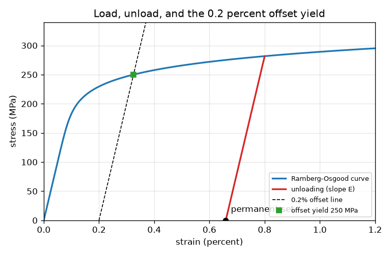
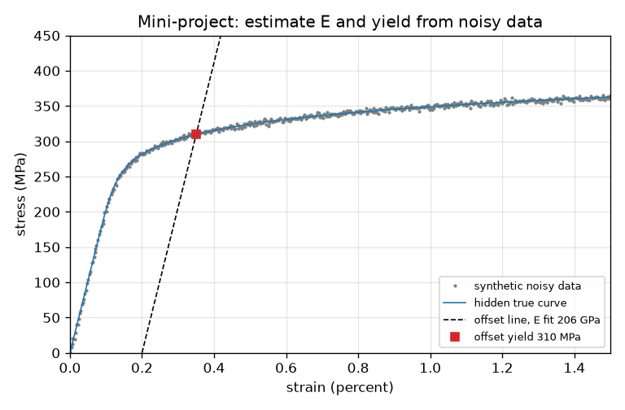

# Session 3: Elastic-plastic simulation, offset yield and uncertainty

*Level 3 (simulation and validation) · about 90 minutes · openstressstrain*

> This is a simplified educational model. It is not a validated design tool and must not be used for real structures, electrical installations, vehicles, industrial processes or medical decisions.

**Prerequisites**

- Session 1: stress, strain, elastic and plastic.
- Session 2: Hooke's law, factor of safety.
- Python loops and NumPy arrays.

**Learning objectives.** After this session you can:

- Simulate loading and unloading of an elastic-plastic metal with strain hardening, and explain permanent set.
- Validate a numerical curve against the analytic elastic slope, the hand-calculated permanent set and the 0.2 percent offset yield.
- Show how uncertainty in E and in yield strength changes stretch and factor of safety.
- Estimate E and yield from noisy (synthetic) tensile test data and state the error.

## A. Real-world problem
Real metals do not have a sharp yield point in a test machine: the curve bends smoothly. So engineers define yield as the stress where a line parallel to the elastic slope, shifted by 0.2 percent strain, crosses the curve. Can we build a model that loads and unloads, find that offset yield numerically, trust it because it matches a hand calculation, and see how much a 10 percent error in the data matters? This is a one-dimensional teaching model with no necking or temperature effects; it is not a validated design tool.

## B. Concept and theory
The Ramberg-Osgood curve adds a power-law plastic strain to Hooke's law: eps = sigma/E + 0.002 (sigma/sigma_02)^n. By construction the plastic part equals 0.002 at sigma = sigma_02, so sigma_02 is the 0.2 percent offset yield; n sets how sharp the knee is. The stress for a given strain is found by bisection. Unloading from any point is elastic with the slope E, so the strain left at zero stress is eps_max - sigma_max / E. A bilinear metal (slope E, then slope H after yield sigma_y) is simulated by a return-mapping solver that keeps the plastic strain as a memory. Because inputs are uncertain, sensitivity is the change of an output when one input changes by plus or minus 10 percent.

| Symbol | Meaning | Unit |
|---|---|---|
| E | Young's modulus | MPa |
| sigma_02 | 0.2 percent offset yield strength | MPa |
| n | Ramberg-Osgood hardening exponent | no unit |
| H | slope after yield (bilinear model) | MPa |
| eps_p | plastic (permanent) strain | no unit |
| alpha | accumulated plastic strain | no unit |
| sigma_max, eps_max | peak stress and strain of the loading | MPa, no unit |

**Assumptions**

- One dimension (a bar in tension and compression); isotropic hardening in the solver.
- Unloading is perfectly elastic with slope E.
- No necking, rate, temperature or fatigue effects; the curve keeps rising, unlike a real test after the ultimate strength.
- Synthetic data are generated from a known hidden material. Not a design tool.

$$ \varepsilon=\frac{\sigma}{E}+0.002\left(\frac{\sigma}{\sigma_{02}}\right)^{n} $$

$$ \varepsilon_p=\varepsilon_{\max}-\frac{\sigma_{\max}}{E},\qquad \sigma_{\max}=\sigma_y+H\left(\varepsilon_{\max}-\frac{\sigma_y}{E}\right)\ \text{(bilinear)} $$

$$ \sigma_{\text{trial}}=E(\varepsilon-\varepsilon_p),\quad f=|\sigma_{\text{trial}}|-(\sigma_y+H_p\alpha),\quad \Delta\gamma=\frac{f}{E+H_p},\quad H_p=\frac{EH}{E-H} $$

## C. Visual explanation
The first figure shows a Ramberg-Osgood curve (E = 200 GPa, 0.2 percent yield 250 MPa, n = 10) loaded to 0.8 percent strain. The red line is the unloading path: it is straight with the elastic slope and hits zero stress at a permanent set of 0.66 percent. The dashed line is the 0.2 percent offset line, and the green square marks where it crosses the curve, at exactly 250 MPa. The second figure shows noisy synthetic test points around a hidden true curve, the fitted offset line, and the yield estimate read from it.

*Ramberg-Osgood curve loaded to 0.8 percent strain, the elastic unloading line, the permanent set and the 0.2 percent offset yield.*

*Synthetic noisy tensile test with the hidden true curve, the fitted offset line and the yield estimate.*

## D. Interactive simulation
Run the lesson (`python start.py 3`), then open the live app: [Session 3: load, unload and offset yield](https://krunalpanchal1995.github.io/openstressstrain/session-03/) (or `app.html` in this folder). Change E, the 0.2 percent yield, the exponent n and the load strain. Watch the permanent set, then open the sensitivity view to see how a 10 percent change in E shifts the elastic strain.

**Challenge.** Pull the metal to at least 1.0 percent strain and still have less than 0.25 percent permanent set after unloading.

## E. Worked example and experiment
**Problem.** A bilinear metal has E = 70 000 MPa, yield 200 MPa and slope H = 7 000 MPa after yield. It is pulled to 2 percent strain and then unloaded. Find the peak stress and the permanent set, and compare with the solver.

1. Yield strain = 200 / 70 000 = 0.002857.
2. Peak stress = 200 + 7000 * (0.02 - 0.002857) = 200 + 120 = 320 MPa.
3. Unloading is elastic, so the elastic strain recovered is 320 / 70 000 = 0.004571.
4. Permanent set = 0.02 - 0.004571 = 0.015429 (1.54 percent).
5. The return-mapping solver gives 320.00 MPa at the top and zero stress at strain 0.01543: it matches the hand calculation.

**Answer.** Peak stress 320 MPa; permanent set 0.01543 (1.54 percent). The solver reproduces both.

**Experiment.** Take a straight paper clip wire, clamp one end, and measure the tip position at rest and after bending it by 5, 10 and 20 degrees and releasing. For small angles the tip returns (elastic); for larger angles a permanent offset remains. Plot the leftover offset against the bend: it starts at zero and then grows. A real wire also hardens, recovers slowly and its first bend is not repeatable, which a one-dimensional model ignores.

## Real-world application and mini-project: Estimate E and yield from a noisy tensile test
A lab hands you stress-strain readings from a tensile test, but the readings are noisy. In this project the data is generated in code (`synthetic_test` in Session 3) from a hidden material, so you can check your answer. Choose the strain or stress window for the straight-line fit of E, then find the 0.2 percent offset yield with `offset_yield`. Repeat for 50 random seeds with `noise_mpa=5.0` and report the mean and spread.

**Deliverable:** A script that prints, for 50 seeds, the mean and standard deviation of the fitted E (GPa) and offset yield (MPa), the worst-case percentage error against the hidden true values (205 GPa and 310 MPa), and saves a plot of one noisy test with its fitted line.

**Success looks like:** Worst-case error below 10 percent for E and below 5 percent for yield over the 50 seeds, with the mean and spread reported in the units MPa and GPa.

## F. Assessment and design challenge
**Question type A: Conceptual.** Why do engineers use the 0.2 percent offset yield instead of the point where the curve first leaves the straight line?

Hint

Can you see exactly where a smooth curve leaves its tangent line?

Step-by-step solution

A smooth curve departs from its straight part gradually, so the 'first point of departure' depends on how closely you look and on noise. The offset construction gives a well-defined, repeatable number that any lab can find from the same data, at the price of choosing 0.2 percent by convention. It means the metal has a permanent set of about 0.2 percent when unloaded at that stress.

**Question type B: Numerical.** A bilinear metal with E = 70 000 MPa, yield 200 MPa and H = 7 000 MPa is pulled to 1 percent strain and unloaded. Find the peak stress and the permanent set.

Hint

Peak stress = yield + H (eps - yield/E). Permanent set = eps - peak / E.

Step-by-step solution

Yield strain = 0.002857. Peak stress = 200 + 7000 * (0.01 - 0.002857) = 250.0 MPa. Permanent set = 0.01 - 250 / 70 000 = 0.006429 (0.64 percent). Units: MPa and no unit. Sanity check: the set must be less than the total strain 0.01.

**Question type C: Graph and simulation interpretation.** Read the sensitivity table for the steel bar (20 kN, 2 m, d = 16 mm). Which input matters for the stretch and which for the safety factor, and by how much for a 10 percent change?

Hint

Extension is proportional to 1/E and the factor of safety to the yield strength.

Step-by-step solution

E -10 percent raises the extension by 11.1 percent (1/0.9 - 1) and E +10 percent lowers it by 9.1 percent; the factor of safety does not depend on E. Yield -10 percent lowers the factor of safety by exactly 10 percent (2.51 to 2.26) and the extension does not depend on yield. So stiffness data controls the stretch check and yield data controls the safety check.

**Question type D: Design and optimisation challenge.** Design: the steel bar must still stretch no more than 1 mm if the real E is 10 percent below the table (180 GPa) and must keep FoS >= 2 if the real yield is 10 percent low (225 MPa). Choose the smallest whole-millimetre diameter and compare its mass with the 16 mm bar.

Hint

Use worst-case E and yield in the formulas of Session 2 (`bar_response(180000, 225, d_mm=...)`).

Step-by-step solution

Stiffness: A >= 20 000 * 2000 / (180 000 * 1) = 222.2 mm^2, so d >= 16.82 mm, which is 17 mm. At 17 mm: extension 0.979 mm and FoS 2.55 (with yield 225 MPa), so both limits pass. The 16 mm bar would stretch 1.105 mm in the worst case. Mass of 17 mm: 3.56 kg against 3.16 kg for 16 mm. Trade-off: robustness against data uncertainty costs about 13 percent more material.

Score yourself with [RUBRIC.md](../../RUBRIC.md). Print the [activity sheet](activity_sheet.md) to work on paper.

## Common misconceptions
| Common misconception | What is actually true |
|---|---|
| Unloading retraces the loading curve. | In the plastic range unloading is elastic with the slope E, so a permanent set stays. |
| The yield stress is one exact number for a metal. | The curve bends smoothly, so yield is defined by a rule (the 0.2 percent offset) and varies from batch to batch. |
| A simulation is validated if its curve looks right. | A model is trusted only after it reproduces independent checks such as the elastic slope, the hand-calculated permanent set and the offset yield, and its limits (no necking) are stated. |

## Glossary
- **strain hardening**: the metal gets stronger as it deforms plastically, so the curve keeps rising
- **permanent set**: strain left when the load is removed
- **offset yield**: stress where the curve meets a line parallel to the elastic slope shifted by 0.2 percent strain
- **return mapping**: a step that pulls a trial stress back onto the yield surface
- **sensitivity**: how much an output changes when an input changes
- **Ramberg-Osgood**: a smooth stress-strain formula with a power-law plastic strain

## Finish
1. Do the three coding tasks in [exercises.md](exercises.md).
2. Run `python start.py 3` again after your changes. It ends with the checkpoint; when it prints `PASS`, you are done. (Checkpoint only: `python start.py check 3`.)

Next: the [roadmap](../../promo/roadmap.md). Session 4 is yours to build.
